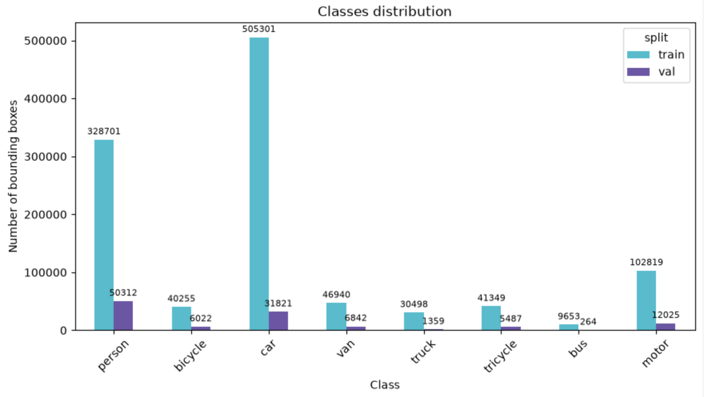
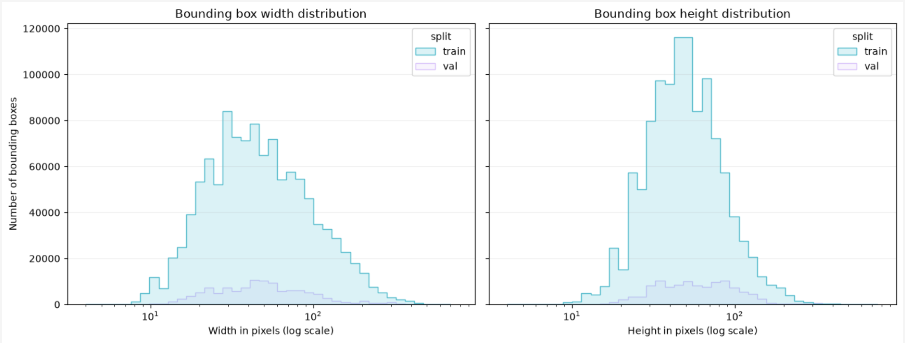
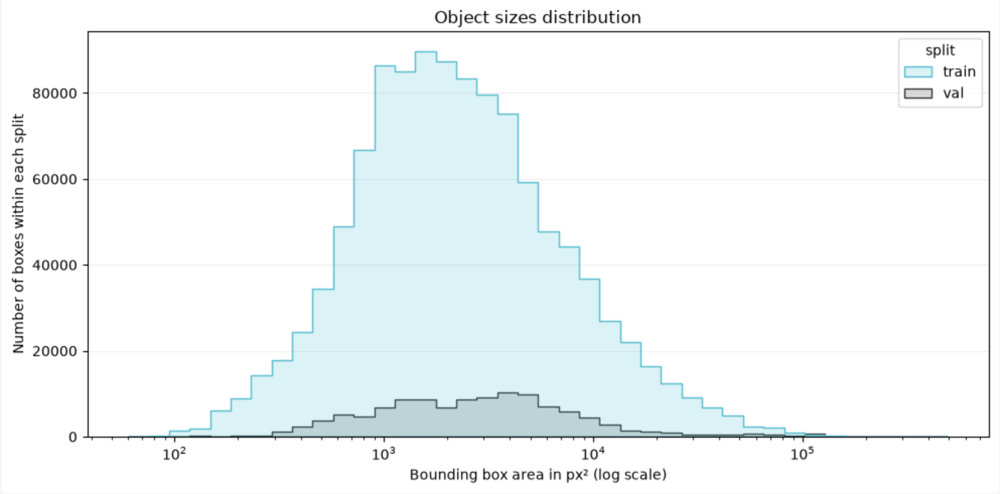
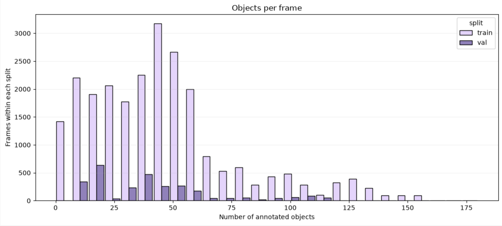

## Introduction
In this homework, I had to explore training Deep Learning models for multiple object video detection task on drone videos from the VisDrone2019-VID benchmark. I experimented with 4 types of Computer Vision models: Two-stage Anchor-based (Faster R-CNN ResNet-50 FPN), One-stage Anchor-based (SSD300 VGG-16), One-stage Anchor-free (YOLO26n) and Query-based (RT-DETR).

## Method

### Data

#### Data Understanding
For data understanding, I have explored the number of clips for each dataset (train, validate, test) along with the the max height and width, min height and width of the images, number of ignored boxes, a check of shared videos, plotted class distribution of the data, area of bounding box along with width and height of boxes.

The data is highly imbalanced - cars are the most frequent class in training, while people class dominate validation. 

Many bounding boxes are only tens of pixels wide and high, which means that reducing image size may make these objects harder to detect. This is also supported by the plot of the area of the bounding boxes. 

Most training frames contain fewer than 50 objects, but some have more than 150, which makes detection in crowded scenes challenging. Validation frames generally contain fewer objects, which means that the model is evaluated on less crowded scenes. 

#### Data Preprocessing
For data augmentation, I applied random horizontal and vertical flips, each with a probability of 50%, and adjusted the changes to the bounding boxes accordingly. These transformations are applied in order to give the model more examples of objects in different orientations. They were only applied to the training data, validation images were unchanged. 
I converted these images from BGR to RGB and transformed them into tensors for the further training. The change of image size was applied according to the models requirements.

### Training

#### Settings
I applied cross-validation to 3 models: the two-stage, one-stage anchor-based and one-stage anchor-free detectors, to find the best hyperparameters for each. The validation folds were created from the training dataset, using every 15th frame. After this search, I trained each final model with its best parameters combination, using every 5th frame from the training dataset. I made this choice after looking at the images and noticing that the frames were mostly similar, with the same objects still present after 5 frames. The reason for sampling fewer frames is to reduce the training and validation time and computational costs.

Overall, my training settings for final models were 8 epochs and 3 hour of training time limit.

#### Metrics
For evaluating the model performance I used mAP, AP50 and AP small metrics.
- Mean average precision(mAP) across classes and IoU thresholds from 0.50 to 0.95, measures overall detection performance
- AP50 - average precision at an IoU threshold of 0.50, where a predicted box must overlap sufficiently with the ground-truth box to count as a correct 
- AP Small - average precision for objects with bounding box areas smaller than 32 by 32 pixels, which measures performance on small objects

IoU - Intersection over Union - metric, which measures how much a predicted bounding box overlaps with the ground-truth box.

##  Two-stage Anchor-based model - Faster R-CNN ResNet-50 FPN
For the two-stage anchor-based model, I chose Faster R-CNN ResNet-50 FPN because it is a widely used model that performs well on object detection tasks.

### Cross-Validation Results
### Baseline

Best results per fold:

| fold | epoch | train_loss | learning_rate | mAP      | AP50     | AP_small |
|------|-------|------------|---------------|----------|----------|----------|
| 0    | 5     | 0.898043   | 0.0001        | 0.147468 | 0.308827 | 0.052301 |
| 1    | 5     | 0.903169   | 0.0001        | 0.170524 | 0.351398 | 0.056580 |
| 2    | 4     | 0.909814   | 0.0001        | 0.112619 | 0.239960 | 0.046442 |

Metrics across folds:

| Statistic | mAP      | AP50     | AP_small |
|-----------|----------|----------|----------|
| Mean      | 0.143537 | 0.300062 | 0.051774 |
| Std       | 0.029152 | 0.056234 | 0.005090 |

The baseline results achieved a mean mAP of approximately 0.1435 across 3 folds, the variation between folds was not significant. AP small metric's mean is only 0.051774, which indicates that detecting small objects was challenging for the model.

### Learning rate scheduler
 For hyperparameter tuning, I decided to use a learning rate scheduler with a step size of 4, reducing the baseline learning rate from starting 1e-4 to 1e-5 after 4 epochs. This was an experiment to see how smaller updates later in training can influence the model performance.

Best results per fold:

| fold | epoch | train_loss | learning_rate | mAP      | AP50     | AP_small |
|------|-------|------------|---------------|----------|----------|----------|
| 0    | 5     | 0.826102   | 0.00001       | 0.173233 | 0.358332 | 0.050640 |
| 1    | 5     | 0.820961   | 0.00001       | 0.184243 | 0.370209 | 0.058439 |
| 2    | 5     | 0.799078   | 0.00001       | 0.130530 | 0.267310 | 0.052389 |

Metrics across folds:

| Statistic | mAP      | AP50     | AP_small |
|-----------|----------|----------|----------|
| Mean      | 0.162669 | 0.331950 | 0.053823 |
| Std       | 0.028372 | 0.056294 | 0.004093 |

The mean mAP improved from 0.143537 to 0.162669 and AP50 and AP small also increased.

### ROI positive fraction
For another experiment, I decided to increase the number of positive fractions of the regions, which Faster R-CNN choose for training, which sufficiently overlap with real objects. I wanted to see whether using more positive examples relative to background regions can better model performance.

Best results per fold:

| fold | epoch | train_loss | learning_rate | mAP      | AP50     | AP_small |
|------|-------|------------|---------------|----------|----------|----------|
| 0    | 5     | 1.325353   | 0.0001        | 0.148626 | 0.325543 | 0.054921 |
| 1    | 5     | 1.321903   | 0.0001        | 0.161628 | 0.331951 | 0.052332 |
| 2    | 5     | 1.264013   | 0.0001        | 0.119536 | 0.251405 | 0.049173 |

Metrics mean and std across folds:

| Statistic | mAP      | AP50     | AP_small |
|-----------|----------|----------|----------|
| Mean      | 0.143263 | 0.302966 | 0.052142 |
| Std       | 0.021552 | 0.044768 | 0.002879 |

Compared to the learning rate scheduler experiment, the mean values of all three metrics decreased. Compared to the baseline, mean AP50 and AP small were slightly higher, but mean mAP was slightly lower.

### Results

| epoch | train_loss | learning_rate | mAP      | AP50     | AP_small |
|-------|------------|---------------|----------|----------|----------|
| 1     | 1.096876   | 0.00010       | 0.154391 | 0.313467 | 0.058761 |
| 2     | 0.912786   | 0.00010       | 0.142678 | 0.312755 | 0.058224 |
| 3     | 0.837375   | 0.00010       | 0.166807 | 0.343651 | 0.082083 |
| 4     | 0.787906   | 0.00010       | 0.171285 | 0.341759 | 0.061356 |
| 5     | 0.670990   | 0.00001       | 0.185281 | 0.362190 | 0.065708 |
| 6     | 0.640327   | 0.00001       | 0.188482 | 0.368054 | 0.062974 |
| 7     | 0.621735   | 0.00001       | 0.186629 | 0.364543 | 0.064630 |
| 8     | 0.607570   | 0.00001       | 0.183003 | 0.360735 | 0.059951 |

For the final model, I used a learning rate scheduler (step size - 4). Using more data and training for more epochs resulted in better validation scores, although these were measured on a different split from cross-validation. The best mAP was achieved at epoch 6, reaching 0.188482, with AP50 of 0.368054 and AP small of 0.062974. After epoch 6, mAP slightly decreased even though the training loss continued to fall, so I selected this checkpoint as the final model.

The region proposal stage of the model finds areas of the image where objects might be. The second stage identifies the objects in these areas and adjusts the bounding boxes to fit them more precisely. If the first stage misses an object, the second stage cannot detect it.
These can cause such failure cases as missing small objects (if for, example, applied augmentation changes reduced some visual details), oclussion of the objects' boxes or confusing of the classes of objects that look alike.

##  One-stage Anchor-based - SSD 300 VGG-16
For the one-stage anchor-based experiment, I chose SSD300 VGG-16 because I wanted to see how a model with a fixed input size of 300 by 300 px would perform compared with the other models.

### Cross-Validation Results
###  Baseline
Best results per fold:

| Fold | Epoch | Train loss | Learning rate | mAP | AP50 | AP_small |
|---|---|---|---|---|---|---|
| 0 | 5 | 3.898374 | 0.0001 | 0.034114 | 0.079434 | 0.005917 |
| 1 | 5 | 3.944425 | 0.0001 | 0.048727 | 0.111486 | 0.005670 |
| 2 | 5 | 3.943019 | 0.0001 | 0.037497 | 0.091989 | 0.006412 |

Metrics mean and std across folds:

| Statistic | mAP | AP50 | AP_small |
|---|---|---|---|
| Mean | 0.040113 | 0.094303 | 0.006000 |
| Std | 0.007650 | 0.016151 | 0.000378 |

The baseline indicated pretty low results on both mAP and AP50. The results were especially low for AP Small, which means that very few small objects were detected.

###  IoU threshold
Based on the previous low results, I wanted to test whether allowing more positive anchor matches during training would help the model learn, that is why I lowered the anchor-matching IoU threshold from 0.5 to 0.4, allowing anchors with less overlap with the ground-truth boxes to become positive training examples.

Best results per fold:

| Fold | Epoch | Train loss | Learning rate | mAP | AP50 | AP_small |
|---|---|---|---|---|---|---|
| 0 | 4 | 3.599671 | 0.0001 | 0.041017 | 0.094176 | 0.005443 |
| 1 | 5 | 3.436188 | 0.0001 | 0.060336 | 0.136415 | 0.005699 |
| 2 | 5 | 3.459713 | 0.0001 | 0.037774 | 0.097184 | 0.006105 |

Metrics mean and std across folds:

| Statistic | mAP | AP50 | AP_small |
|---|---|---|---|
| Mean | 0.046375 | 0.109258 | 0.005749 |
| Std | 0.012198 | 0.023566 | 0.000334 |

This experiment have bettered mAP and AP50 metrics, but as expected slightly lowered detection of the small objects, because of 
the tolerance to IoU. 

### Positive fraction
For this experiment, I increased the positive fraction from 0.25 to 0.5 to test if giving object examples more weight relative to background examples would improve detection. 

Best results per fold:

| Fold | Epoch | Train loss | Learning rate | mAP | AP50 | AP_small |
|---|---|---|---|---|---|---|
| 0 | 4 | 3.491223 | 0.0001 | 0.030561 | 0.060355 | 0.002595 |
| 1 | 5 | 3.348580 | 0.0001 | 0.040778 | 0.083547 | 0.003209 |
| 2 | 5 | 3.364603 | 0.0001 | 0.026028 | 0.059766 | 0.003566 |

Metrics mean and std across folds:

| Statistic | mAP | AP50 | AP_small |
|---|---|---|---|
| Mean | 0.032456 | 0.067889 | 0.003123 |
| Std | 0.007555 | 0.013563 | 0.000491 |

This experiment has lowered all of the metrics. The possible reason for this is that fewer negative examples weakened the model’s ability to distinguish objects from background.

### Results
| Epoch | Train loss | Learning rate | mAP | AP50 | AP_small |
|---|---|---|---|---|---|
| 1 | 4.626553 | 0.0001 | 0.050752 | 0.118280 | 0.007082 |
| 2 | 3.497785 | 0.0001 | 0.060435 | 0.137710 | 0.006624 |
| 3 | 3.097881 | 0.0001 | 0.053735 | 0.128880 | 0.007204 |
| 4 | 2.830493 | 0.0001 | 0.054024 | 0.129214 | 0.005797 |
| 5 | 2.641353 | 0.0001 | 0.059821 | 0.139782 | 0.009018 |
| 6 | 2.499708 | 0.0001 | 0.061381 | 0.144902 | 0.010724 |
| 7 | 2.379168 | 0.0001 | 0.061150 | 0.146110 | 0.006248 |
| 8 | 2.283222 | 0.0001 | 0.055711 | 0.131893 | 0.008913 |

For the final model, I have chosen IoU threshold setting. The overall result on more data and with using 
validation dataset has shown a little bit better results (with mean mAP - 0.061381, AP50 - 0.144902 and AP Small - 0.010724) 
than the cross-validation ones, but significantly lower than two-stage anchor-based. One possible reason for this can be the fixed input size, which can make small objects harder to distinguish. Removing the proposal stage may also contribute to this, as SSD predicts classes and bounding boxes directly from anchors, without a separate stage that extracts features from candidate regions and further refines their predictions. This can make small or distorted objects harder to detect. Potential improvements to these problems can be a larger input resolution and adapting anchor sizes to the object sizes observed in the dataset. 

##  One-stage Anchor-free - YOLO26n
For this method, I chose YOLO26n model because it is lightweight architecture makes it easy 
to experiment with different settings, it is also known for good object detection task performance, 
especially on smaller objects, which is particularly interesting to observe (compared to the previous experiments with bad performance for them).

### Cross-Validation Results
### Baseline
Best results per fold:

| Fold | Epoch | Train loss | Learning rate | mAP | AP50 | AP_small |
|---|---|---|---|---|---|---|
| 0 | 5 | 4.028758 | 0.000021 | 0.070883 | 0.143081 | 0.011915 |
| 1 | 5 | 4.257132 | 0.000021 | 0.078074 | 0.153604 | 0.022963 |
| 2 | 5 | 4.157253 | 0.000021 | 0.062448 | 0.126201 | 0.015255 |

Metrics mean and std across folds:

| Statistic | mAP | AP50 | AP_small |
|---|---|---|---|
| Mean | 0.070468 | 0.140962 | 0.016711 |
| Std | 0.007821 | 0.013824 | 0.005666 |

The baseline results show a pretty low mAP, but already higher results for AP small.
The reason for such results can also be the size of the frame on which training was performed, which is
640 by 640 px. This size as was spotted from the previous model experiment losses information
about objects (despite the fact that model is still better for smaller objects).

### Image size
For the first experiment, I tried to fix the baseline problem of small frame size.

Best results per fold:

| Fold | Epoch | Train loss | Learning rate | mAP | AP50 | AP_small |
|---|---|---|---|---|---|---|
| 0 | 5 | 3.648657 | 0.000021 | 0.114911 | 0.220943 | 0.029350 |
| 1 | 5 | 3.874518 | 0.000021 | 0.125663 | 0.236429 | 0.040508 |
| 2 | 5 | 3.793124 | 0.000021 | 0.100303 | 0.194719 | 0.032385 |

Metrics mean and stad across folds:

| Statistic | mAP | AP50 | AP_small |
|---|---|---|---|
| Mean | 0.113626 | 0.217364 | 0.034081 |
| Std | 0.012729 | 0.021084 | 0.005769 |

As a result, this experiment greatly increased the model performance - from mAP being approximately 0.07
to 0.11 and also increasing AP small.

### Image size and box-weight
For another experiment, I kept the larger image size and increased the box loss weight to test whether
giving more importance to bounding box accuracy would improve detection.

Best results per fold:

| Fold | Epoch | Train loss | Learning rate | mAP | AP50 | AP_small |
|---|---|---|---|---|---|---|
| 0 | 5 | 4.300518 | 0.000021 | 0.110873 | 0.210263 | 0.030204 |
| 1 | 5 | 4.551395 | 0.000021 | 0.126686 | 0.237058 | 0.039484 |
| 2 | 5 | 4.465584 | 0.000021 | 0.104055 | 0.199413 | 0.033606 |

Metrics mean and std across folds:

| Statistic | mAP | AP50 | AP_small |
|----------|----|-----|---------|
| Mean | 0.113871 | 0.215578 | 0.034431 |
| Std | 0.011609 | 0.019377 | 0.004695 |

This experiment showed small mAP and AP increasing (AP50 decreased slightly).
This change provided little additional improvement.

### Results

| Epoch | Train loss | Learning rate | mAP | AP50 | AP_small |
|---|---|---|---|---|---|
| 1 | 4.843106 | 0.000033 | 0.094871 | 0.182696 | 0.042098 |
| 2 | 4.413879 | 0.000058 | 0.118980 | 0.226191 | 0.048020 |
| 3 | 4.216195 | 0.000075 | 0.124316 | 0.237891 | 0.053133 |
| 4 | 4.094600 | 0.000063 | 0.122705 | 0.235284 | 0.050181 |
| 5 | 4.021062 | 0.000051 | 0.127733 | 0.247463 | 0.052381 |
| 6 | 3.983841 | 0.000038 | 0.125470 | 0.243783 | 0.052455 |
| 7 | 3.945152 | 0.000026 | 0.128281 | 0.249269 | 0.055037 |
| 8 | 3.934860 | 0.000013 | 0.128097 | 0.249480 | 0.054563 |

For the final model training, I have chosen the previous experiment settings,
which resulted in mean validation mAP of 0.128281, AP50 of 0.249269 and AP small of 0.055037.
Even with the larger frame input size, YOLO26n performed generally worse than Faster R-CNN. 
One possible reason is its smaller model capacity.

YOLO predicts objects from points on its feature maps. During training, suitable points are assigned to each real object, and the model learns to predict 
its class and bounding box from these points. Small objects can cover only a few points, which makes them easier to miss.
When the scene is dense, separating them for model is harder because of the possible overlap.

To summarize, I tested two input image sizes: 640 by 640 and 1024 by 1024 px. 
I also tested box loss weights of 7.5 and 10.0. 

## Query-based - RT-DETR
For the experiment with query-based model, I chose the RT-DETR with a ResNet-50 backbone
using the Hugging Face pretrained checkpoint PekingU/rtdetr_r50vd. Each training experiment
was conducted under the same training budget as the other final models (8 epoch and 3 hours), with 150 queries.

### Baseline

#### Results
| Epoch | Train loss | Learning rate | mAP | AP50 | AP_small |
|---|---|---|---|---|---|
| 1 | 19.842538 | 0.0001 | 0.195851 | 0.369998 | 0.075240 |
| 2 | 16.714759 | 0.0001 | 0.189932 | 0.364690 | 0.069144 |
| 3 | 15.995673 | 0.0001 | 0.176813 | 0.339162 | 0.066763 |
| 4 | 15.482699 | 0.0001 | 0.160412 | 0.315649 | 0.075259 |
| 5 | 15.160812 | 0.0001 | 0.164690 | 0.317023 | 0.058824 |

This baseline result have already showed better results than other final models.
One possible reason is that RT-DETR uses attention from transformers architecture to combine information from
different parts of the image, which can be helpful in distinguishing objects in dense scenes.

### Increased matcher bounding box cost

For the experiment, I decided to make box position and size more important (from 5 to 7) when deciding which 
prediction should be matched to each object during training.

#### Results
| Epoch | Train loss | Learning rate | mAP | AP50 | AP_small |
|---|---|---|---|---|---|
| 1 | 20.401495 | 0.0001 | 0.167014 | 0.326893 | 0.065975 |
| 2 | 16.679747 | 0.0001 | 0.197511 | 0.375035 | 0.086031 |
| 3 | 15.957157 | 0.0001 | 0.181720 | 0.347951 | 0.065679 |
| 4 | 15.491259 | 0.0001 | 0.177088 | 0.334083 | 0.079237 |
| 5 | 15.190967 | 0.0001 | 0.176147 | 0.338466 | 0.073406 |

This setting helped to slightly better the mAP and AP small metrics.

### Increased matcher bounding box cost with a learning rate scheduler
In this experiment, I decided to use previous approach with learning rate scheduler because
at epoch 2 validation performance started to decrease while training loss continued to fall.
I wanted to test if smaller updates in training can help improve validation results.

#### Results
| Epoch | Train loss | Learning rate | mAP | AP50 | AP_small |
|---|---|---|---|---|---|
| 1 | 19.901523 | 0.00010 | 0.189146 | 0.362727 | 0.070558 |
| 2 | 16.684536 | 0.00010 | 0.184881 | 0.351121 | 0.067154 |
| 3 | 16.017037 | 0.00010 | 0.173154 | 0.341661 | 0.064835 |
| 4 | 15.495235 | 0.00010 | 0.170983 | 0.333922 | 0.080953 |
| 5 | 14.669228 | 0.00001 | 0.200798 | 0.382026 | 0.079655 |

As a result, this combination achieved the highest mAP of 0.200798 and AP50 of 0.382026 
among the other tested models. Validation performance improved after the learning rate was reduced. 
However, AP small reached 0.079655, which is lower than the result without the scheduler.

An important remark is that the model has not converged within the budget, each experiment completing 5/8 epochs.
During training, bipartite matching pairs each object with 1 prediction, considering the predicted class and bounding box accuracy.
Unmatched predictions are trained to predict no object, which removes the possibility of couple of predictions detecting the same object.
This allows RT-DETR to produce detections without NMS, which removes overlapping duplicate predictions. In dense scenes, avoiding NMS can help preserve detections of objects whose boxes overlap. 

## Pipeline

### Settings
As the baseline of my pipeline I have used query-based RT-DETR model with increased matching boxes and scheduler, 
because it provided the best results previously. I changed the data augmentation process by removing vertical flip and testing saturation and brightness
settings. The training settings were also changed - 5 hours for 8 epochs for 2 experiments and 7 hours and 12 epochs for the last one, each third (fourth for the last one) frame was taken from training dataset, 
150 queries for first 2 experiments and 200 for last one.

###  Data Augmentation
##### Results
| Epoch | Train loss | Learning rate | mAP | AP50 | AP_small |
|------|-----------|--------------|----|-----|---------|
| 1 | 17.859426 | 0.00010 | 0.189632 | 0.361983 | 0.089789 |
| 2 | 15.213238 | 0.00010 | 0.174743 | 0.339759 | 0.089948 |
| 3 | 14.433858 | 0.00010 | 0.188732 | 0.358286 | 0.087055 |
| 4 | 13.873146 | 0.00010 | 0.179524 | 0.349204 | 0.081197 |
| 5 | 12.884164 | 0.00001 | 0.186961 | 0.358383 | 0.079153 |

In this experiment, I applied the new data augmentation settings, which resulted in lower mAP(0.189632), but better AP small metric (0.089789).
However, the training budget was also too low to complete all the epochs with the increased amount of data.

### Increased queries number
##### Results
| Epoch | Train loss | Learning rate | mAP | AP50 | AP_small |
|------|-----------|--------------|----|-----|---------|
| 1 | 17.167127 | 0.00010 | 0.187137 | 0.369546 | 0.091081 |
| 2 | 14.703969 | 0.00010 | 0.167438 | 0.332049 | 0.091170 |
| 3 | 13.969344 | 0.00010 | 0.186596 | 0.368600 | 0.094979 |
| 4 | 13.428951 | 0.00010 | 0.180202 | 0.347011 | 0.076305 |
| 5 | 12.497414 | 0.00001 | 0.216693 | 0.409408 | 0.087624 |

For another settings search, I decided to increase the number of queries to 200 (this number was chosen from the plot of number of bounding boxes on frames). 
This setting actually bettered the model performance. 5 epochs were runed out of 8, 

### Increased queries number, budget and number of frames
##### Results

| Epoch | Train loss | Learning rate | mAP | AP50 | AP_small |
|------:|-----------:|--------------:|----:|-----:|---------:|
| 1 | 17.815433 | 0.000100 | 0.175416 | 0.349005 | 0.073167 |
| 2 | 15.082941 | 0.000100 | 0.204482 | 0.392652 | 0.074937 |
| 3 | 14.383378 | 0.000100 | 0.193552 | 0.376385 | 0.074431 |
| 4 | 13.884990 | 0.000100 | 0.195762 | 0.376848 | 0.083007 |
| 5 | 12.981619 | 0.000010 | 0.241460 | 0.445040 | 0.073886 |
| 6 | 12.719409 | 0.000010 | 0.257927 | 0.463701 | 0.081673 |
| 7 | 12.527769 | 0.000010 | 0.248560 | 0.448173 | 0.076538 |
| 8 | 12.395668 | 0.000010 | 0.244922 | 0.441552 | 0.069847 |
| 9 | 12.262281 | 0.000001 | 0.249393 | 0.447716 | 0.075716 |
| 10 | 12.230590 | 0.000001 | 0.249880 | 0.447819 | 0.075260 |

Best validation results — epoch 6:

| Epoch | mAP | AP50 | AP_small |
|------:|----:|-----:|---------:|
| 6 | 0.257927 | 0.463701 | 0.081673 |

In this experiment, I increased the number of queries, the training budget and the number of training frames. 
This combination achieved the highest mAP of 0.257927 and AP50 of 0.463701, with AP small of 0.081673. 
The larger budget allowed all epochs to finish, although validation mAP did not improve after epoch 6.
This approach showed the best score on the private leaderboard among my other models.

## Conclusion

> In this homework, I compared 4 object detection architectures on drone videos for the multiple object detection task.
A real challenge for my approach was small objects and crowded scenes, as well as limited computational resources.
RT-DETR query-based model achieved the highest validation mAP.
The experiments also showed that lower training loss did not always lead to better validation results.
Possible improvements to this method include combining models with different strengths
(for example, one that performs better in general and one that is better at detecting smaller objects),
testing additional data augmentations and further tuning the models, possibly by giving more budget to training or trying various post-training methods.

