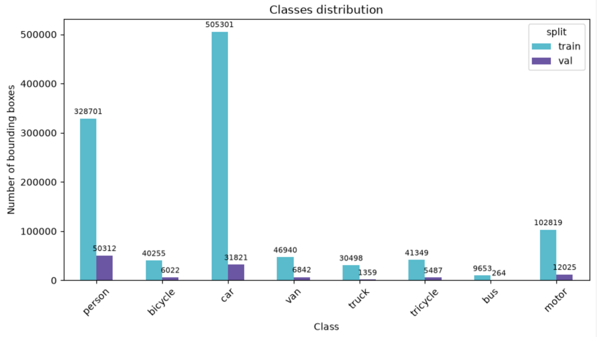
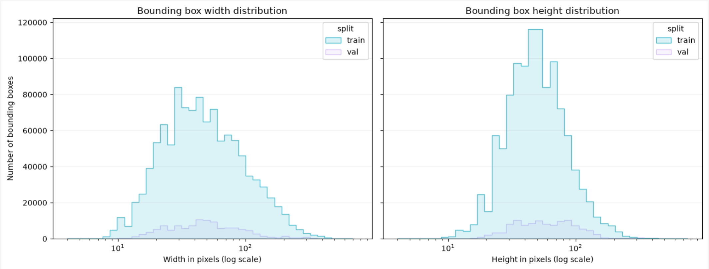
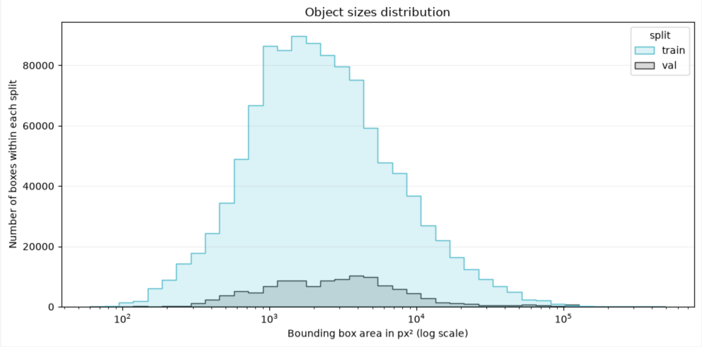
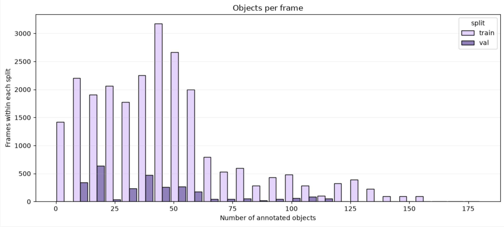

## Introduction
In this homework, I had to explore training Deep Learning models for multiple object video detection task on drone videos from the VisDrone2019-VID benchmark. I experimented with 4 types of Computer Vision models: Two-stage Anchor-based (Faster R-CNN ResNet-50 FPN), One-stage Anchor-based (SSD VGG-16), One-stage Anchor-free (YOLO26n) and Query-based (RT-DETR).

## Method

### Data

#### Data Understanding
For data understanding, I have explored the number of clips for each dataset (train, validate, test) along with the the max height and width, min height and width of the images, number of ignored boxes, a check of shared videos, plotted class distribution of the data, area of bounding box along with width and height of boxes.

The data is highly imbalanced - cars are the most frequent class in training, while people class dominate validation. 

Many bounding boxes are only tens of pixels wide and high, which means that reducing image size may make these objects harder to detect. This is also supported by the plot of the area of the bounding boxes. 

Most training frames contain fewer than 50 objects, but some have more than 150, which makes detection in crowded scenes challenging. Validation frames generally contain fewer objects, which means that the model is evaluated on less crowded scenes. 

#### Data Preprocessing
For data augmentation, I applied random horizontal and vertical flips, each with a probability of 50%, and adjusted the changes to the bounding boxes accordingly. These transformations are applied in order to give the model more examples of objects in different orientations. They were only applied to the training data, validation images were unchanged. 
I converted these images from BGR to RGB and transformed them into tensors for the further training. The change of image size was applied according to the models requirements.

### Training

#### Settings
I applied cross-validation to 3 models: the two-stage, one-stage anchor-based and one-stage anchor-free detectors, to find the best hyperparameters for each. The validation folds were created from the training dataset, using every 15th frame. After this search, I trained each final model with its best parameters combination, using every 5th frame from the training dataset. I made this choice after looking at the images and noticing that the frames were mostly similar, with the same objects still present after 5 frames. The reason for sampling fewer frames is to reduce the training and validation time and computational costs.

Overall, my training settings for final models were 8 epochs and 3 hour of training time limit.

#### Metrics
For evaluating the model performance I used mAP, AP50 and AP small metrics.
- Mean average precision(mAP) across classes and IoU thresholds from 0.50 to 0.95, measures overall detection performance
- AP50 - average precision at an IoU threshold of 0.50, where a predicted box must overlap sufficiently with the ground-truth box to count as a correct 
- AP Small - average precision for objects with bounding box areas smaller than 32 by 32 pixels, which measures performance on small objects

IoU - Intersection over Union - metric, which measures how much a predicted bounding box overlaps with the ground-truth box.

###  Two-stage Anchor-based model - Faster R-CNN ResNet-50 FPN
For the two-stage anchor-based model, I chose Faster R-CNN ResNet-50 FPN because it is a widely used model that performs well on object detection tasks.

#### Cross Validation Results
##### Baseline

Best results per fold:

| fold | epoch | train_loss | learning_rate | mAP      | AP50     | AP_small |
|------|-------|------------|---------------|----------|----------|----------|
| 0    | 5     | 0.898043   | 0.0001        | 0.147468 | 0.308827 | 0.052301 |
| 1    | 5     | 0.903169   | 0.0001        | 0.170524 | 0.351398 | 0.056580 |
| 2    | 4     | 0.909814   | 0.0001        | 0.112619 | 0.239960 | 0.046442 |

Metrics across folds:

| Statistic | mAP      | AP50     | AP_small |
|-----------|----------|----------|----------|
| Mean      | 0.143537 | 0.300062 | 0.051774 |
| Std       | 0.029152 | 0.056234 | 0.005090 |

The baseline results achieved a mean mAP of approximately 0.1435 across 3 folds, the variation between folds was not significant. AP small metric's mean is only 0.051774, which indicates that detecting small objects was challenging for the model.

##### Learning rate scheduler
 For hyperparameter tuning, I decided to use a learning rate scheduler with a step size of 4, reducing the baseline learning rate from starting 1e-4 to 1e-5 after 4 epochs. This was an experiment to see how smaller updates later in training can influence the model performance.

Best results per fold:

| fold | epoch | train_loss | learning_rate | mAP      | AP50     | AP_small |
|------|-------|------------|---------------|----------|----------|----------|
| 0    | 5     | 0.826102   | 0.00001       | 0.173233 | 0.358332 | 0.050640 |
| 1    | 5     | 0.820961   | 0.00001       | 0.184243 | 0.370209 | 0.058439 |
| 2    | 5     | 0.799078   | 0.00001       | 0.130530 | 0.267310 | 0.052389 |

Metrics across folds:

| Statistic | mAP      | AP50     | AP_small |
|-----------|----------|----------|----------|
| Mean      | 0.162669 | 0.331950 | 0.053823 |
| Std       | 0.028372 | 0.056294 | 0.004093 |

The mean mAP improved from 0.143537 to 0.162669 and AP50 and AP small also increased.

##### ROI positive fraction
For another experiment, I decided to increase the number of positive fractions of the regions, which Faster R-CNN choose for training, which sufficiently overlap with real objects. I wanted to see whether using more positive examples relative to background regions can better model performance.

Best results per fold:

| fold | epoch | train_loss | learning_rate | mAP      | AP50     | AP_small |
|------|-------|------------|---------------|----------|----------|----------|
| 0    | 5     | 1.325353   | 0.0001        | 0.148626 | 0.325543 | 0.054921 |
| 1    | 5     | 1.321903   | 0.0001        | 0.161628 | 0.331951 | 0.052332 |
| 2    | 5     | 1.264013   | 0.0001        | 0.119536 | 0.251405 | 0.049173 |

Metrics across folds:

| Statistic | mAP      | AP50     | AP_small |
|-----------|----------|----------|----------|
| Mean      | 0.143263 | 0.302966 | 0.052142 |
| Std       | 0.021552 | 0.044768 | 0.002879 |

Compared to the learning rate scheduler experiment, the mean values of all three metrics decreased. Compared to the baseline, mean AP50 and AP small were slightly higher, but mean mAP was slightly lower.

#### Results

| epoch | train_loss | learning_rate | mAP      | AP50     | AP_small |
|-------|------------|---------------|----------|----------|----------|
| 1     | 1.096876   | 0.00010       | 0.154391 | 0.313467 | 0.058761 |
| 2     | 0.912786   | 0.00010       | 0.142678 | 0.312755 | 0.058224 |
| 3     | 0.837375   | 0.00010       | 0.166807 | 0.343651 | 0.082083 |
| 4     | 0.787906   | 0.00010       | 0.171285 | 0.341759 | 0.061356 |
| 5     | 0.670990   | 0.00001       | 0.185281 | 0.362190 | 0.065708 |
| 6     | 0.640327   | 0.00001       | 0.188482 | 0.368054 | 0.062974 |
| 7     | 0.621735   | 0.00001       | 0.186629 | 0.364543 | 0.064630 |
| 8     | 0.607570   | 0.00001       | 0.183003 | 0.360735 | 0.059951 |

For the final model, I used a learning rate scheduler (step size - 4). Using more data and training for more epochs resulted in better validation scores, although these were measured on a different split from cross-validation. The best mAP was achieved at epoch 6, reaching 0.188482, with AP50 of 0.368054 and AP small of 0.062974. After epoch 6, mAP slightly decreased even though the training loss continued to fall, so I selected this checkpoint as the final model.

The region proposal stage of the model finds areas of the image where objects might be. The second stage identifies the objects in these areas and adjusts the bounding boxes to fit them more precisely. If the first stage misses an object, the second stage cannot detect it. These can cause such failure cases as missing small objects (if for, example, applied augmentation changes reduced some visual details), oclussion of the objects' boxes or confusing of the classes of objects that look alike.

###  Two-stage Anchor-based model - Faster R-CNN ResNet-50 FPN

#### Cross Validation Results

#####  Baseline
##### 

#### Results

## Conclusion

> Summarize your findings here.
